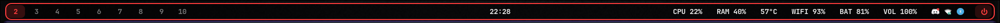

# waybar-terminal

A minimal terminal-style Waybar for Hyprland: dark translucent bar, thin red border, rounded corners, JetBrainsMono Nerd Font.

- **Left:** workspaces, the active one highlighted in red
- **Center:** clock (click it to toggle the date)
- **Right:** CPU, RAM, temperature, network, battery, volume, tray and a power button

## Install

    mkdir -p ~/.config/waybar/custom
    cp config.jsonc style.css ~/.config/waybar/custom/
    waybar -c ~/.config/waybar/custom/config.jsonc -s ~/.config/waybar/custom/style.css

Needs: waybar, JetBrainsMono Nerd Font, pavucontrol (volume click), wlogout (power button).

## Credits

Runs on top of [JaKooLit's Hyprland-Dots](https://github.com/JaKooLit/Hyprland-Dots).
